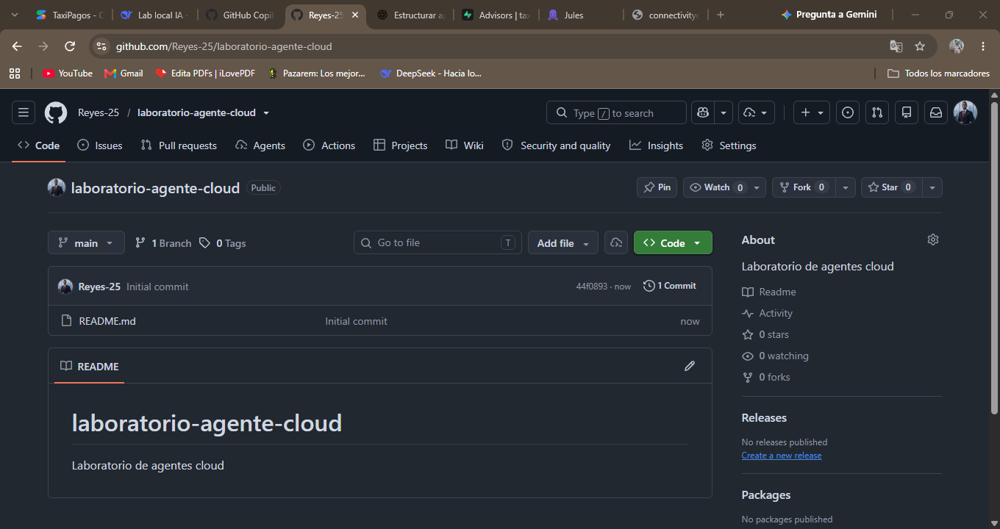
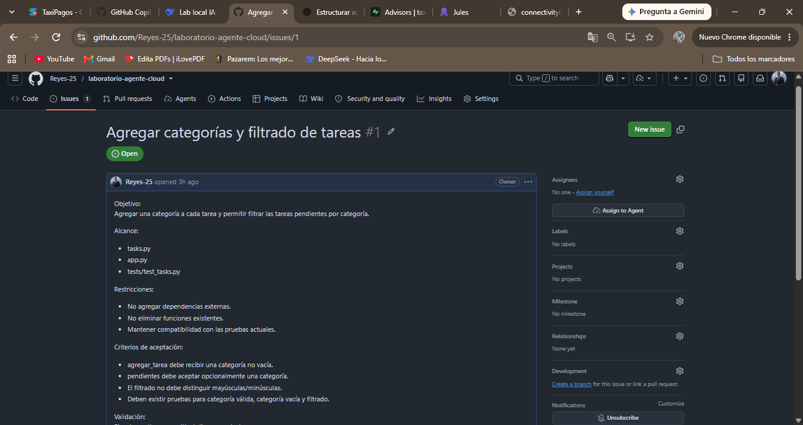
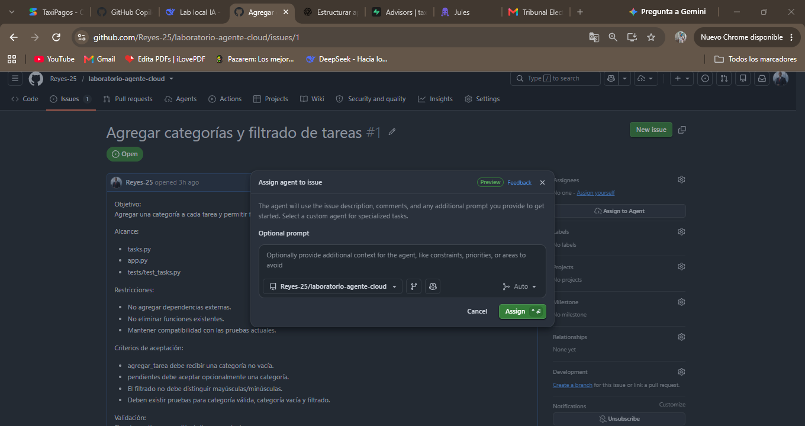
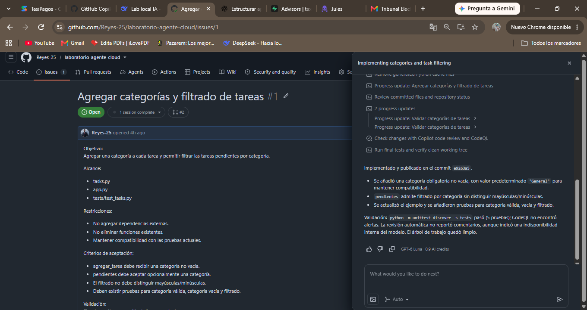
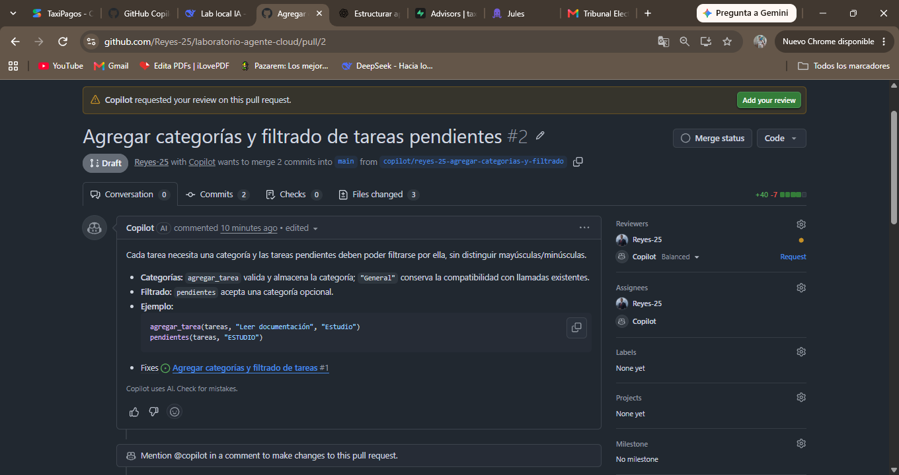
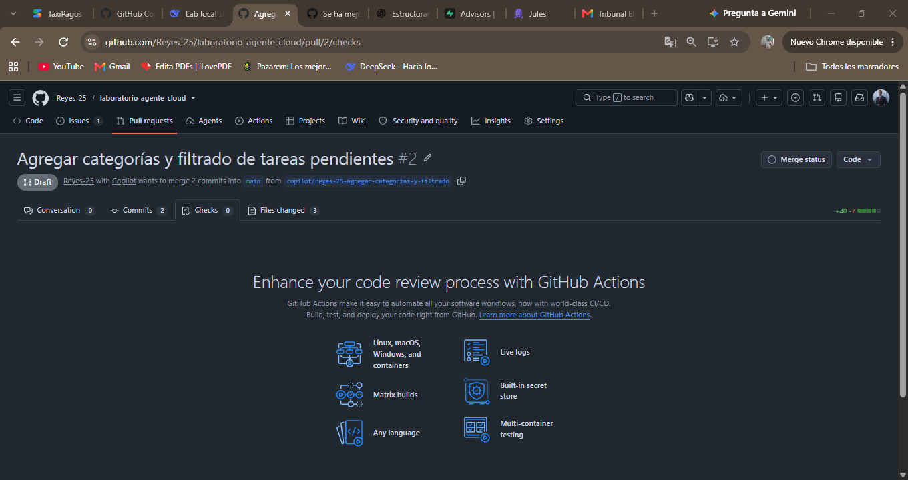
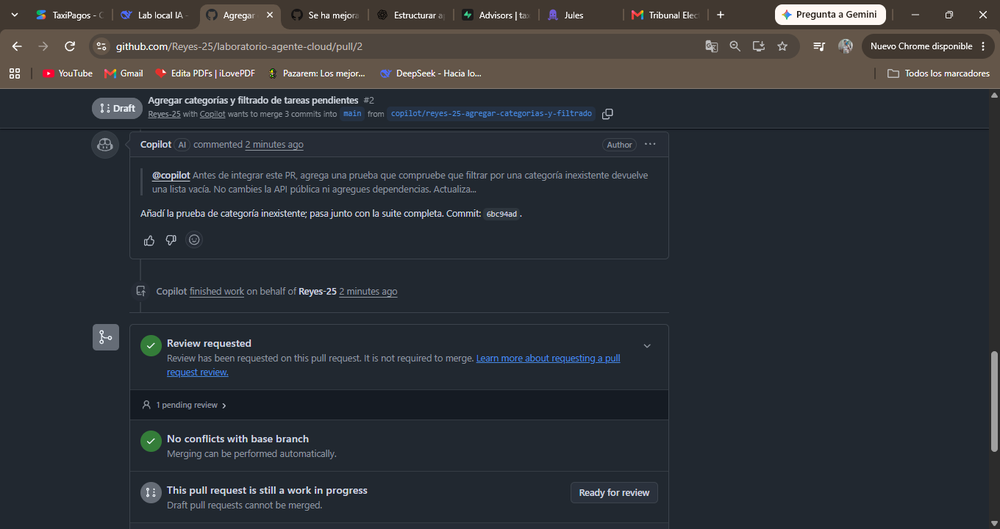
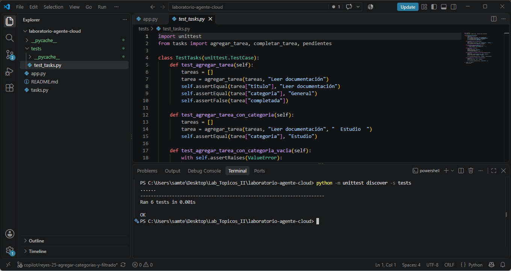
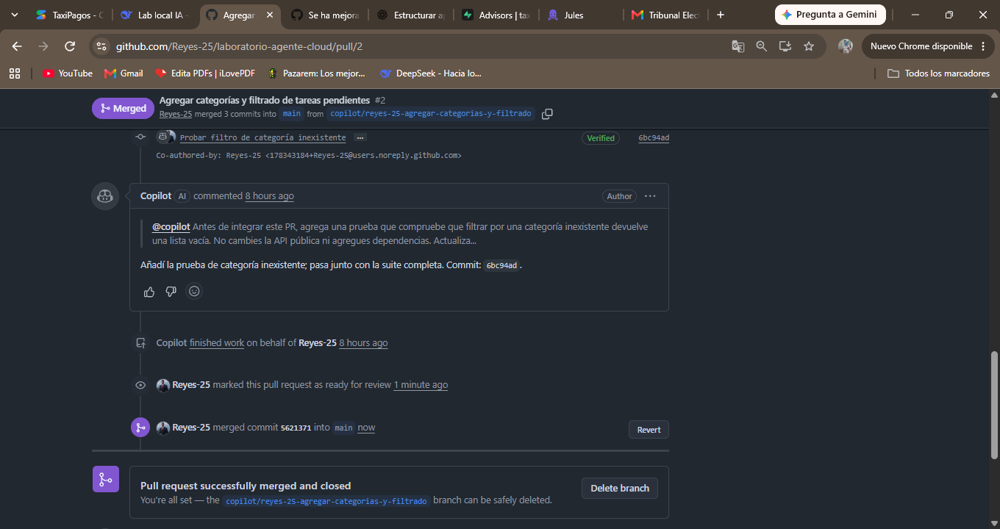
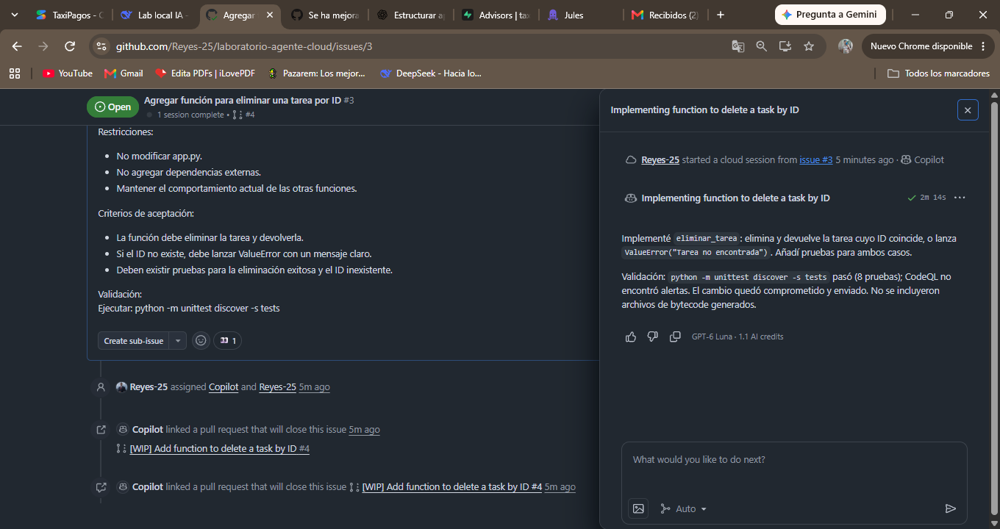

# Laboratorio 12: Agente Cloud — Delegación y Revisión

---

## Paso 2: Crear el repositorio en GitHub

**Explicación breve:** Creé un repositorio público llamado `laboratorio-agente-cloud` en GitHub, inicializado con un README.

**Captura del repositorio:**

---

## Pasos 3, 4 y 5: Crear los archivos base

**Explicación breve:** Creé los archivos `tasks.py`, `app.py` y `tests/test_tasks.py` directamente desde la web de GitHub, usando el código proporcionado en el PDF.

*(Sin captura — son archivos de código)*

---

## Paso 7 y 8: Crear el Issue con objetivo, alcance, restricciones, criterios y validación

**Explicación breve:** Creé un issue titulado "Agregar categorías y filtrado de tareas" con todas las secciones que pide el PDF (Objetivo, Alcance, Restricciones, Criterios de aceptación, Validación). Este issue es lo suficientemente detallado como para que otro desarrollador (o un agente) pueda implementarlo sin preguntar qué significa "terminado".

**Captura del Issue original:**

---

## Paso 10: Delegar el Issue al agente cloud

**Explicación breve:** Asigné el issue a GitHub Copilot Cloud Agent usando el botón "Assign to Agent". El agente comenzó a trabajar en un entorno remoto.

**Captura de la delegación:**

---

## Paso 11: Observar el trabajo en entorno remoto

**Explicación breve:** Mientras el agente trabajaba, pude ver su sesión en tiempo real. La etiqueta "1 session running" indicaba que estaba activo. En la pestaña "Agents" pude ver cómo leía los archivos y ejecutaba las pruebas.

**Captura de la sesión remota:**

---

## Paso 12 y 13: El agente publica el Pull Request

**Explicación breve:** El agente creó una rama `copilot/reyes-25-agregar-categorias-y-filtrado` y abrió un Pull Request en modo "Draft". En su descripción explicó qué archivos modificó, las decisiones que tomó y que ejecutó las pruebas.

**Captura del Pull Request:**

---

## Paso 14: Revisar el diff archivo por archivo

**Explicación breve:** Revisé el diff y confirmé que el agente solo tocó `tasks.py`, `app.py` y `tests/test_tasks.py`. Agregó el parámetro `categoria` a `agregar_tarea`, implementó el filtrado en `pendientes` y agregó las pruebas correspondientes. No agregó dependencias externas.

**Capturas del diff:**

---

## Paso 15: Revisar los checks y pruebas

**Explicación breve:** La pestaña "Checks" mostró 0 checks. No hay un pipeline de CI/CD configurado en el repositorio. La única evidencia de que las pruebas pasaron es el reporte del agente en su descripción del PR (indicó que ejecutó `python -m unittest` y las 5 pruebas pasaron).

**Captura de los checks:**

---

## Paso 16: Buscar un caso no cubierto

**Explicación breve:** Revisando el código, noté que el agente no había agregado una prueba para el caso de filtrar por una categoría que no existe. El código actual devolvería una lista vacía, pero no había una prueba explícita que lo verificara.

**Captura del diff de tests (donde se nota la ausencia de esa prueba):**

---

## Paso 17: Solicitar una iteración mediante comentario

**Explicación breve:** Dejé un comentario en el PR mencionando a `@copilot` y pidiendo explícitamente que agregara la prueba faltante, sin cambiar la API ni agregar dependencias. Luego hice clic en "Start new session" para activar al agente.

**Captura del comentario:**

---

## Paso 18: Comprobar que el agente actualizó el mismo PR

**Explicación breve:** El agente respondió al comentario indicando que había añadido la prueba (commit `ebc9a4d`). El PR ahora mostraba 3 commits en lugar de 2. La retroalimentación fue atendida sin introducir cambios ajenos.

**Captura de la segunda iteración:**

---

## Paso 19: Validar localmente el resultado final

**Explicación breve:** Cloné el repositorio en mi computadora, me cambié a la rama del PR y ejecuté `python -m unittest discover -s tests`. Todas las pruebas pasaron (OK).

**Captura de la validación local:**

---

## Paso 20 y 21: Decidir y hacer merge

**Explicación breve:** Después de validar el código, el alcance y las pruebas, decidí aprobar el PR. Hice clic en "Ready for review" y luego en "Merge pull request". El PR se fusionó exitosamente a la rama `main`.

**Captura del merge:**

---

## Paso 22: Revisar la trazabilidad del trabajo

**Explicación breve:** En GitHub quedó registrado todo el proceso: el issue original, la asignación a Copilot, la sesión del agente, los commits, el diff revisado, el comentario de iteración, la segunda iteración y el merge final. Esta trazabilidad es mucho más rica que la de un chat web tradicional.

*(Sin captura — es una nota escrita)*

---

## Paso 23: Reto final (Segundo issue)

**Explicación breve:** Creé un segundo issue titulado "Agregar función para eliminar una tarea por ID", con objetivo, alcance, restricciones, criterios y validación. Lo asigné a Copilot y el agente generó el Pull Request #4. Revisé el diff, validé localmente (8 pruebas OK) y fusioné el PR.

**Captura del segundo issue:**

**Captura del segundo PR:**

**Capturas del diff del segundo PR:**

**Captura del merge del segundo PR:**

**Captura de la validación local del segundo PR:**

---

## Conclusión

Este laboratorio me demostró el poder de los agentes cloud. A diferencia de un CLI Agent (que trabaja en mi terminal), el agente cloud trabaja en un entorno remoto de forma asíncrona, lo que me permite delegar tareas y revisarlas después sin necesidad de estar frente a la computadora.

El flujo de trabajo (Issue → Agente → PR → Revisión → Merge) es una excelente frontera de control: el agente propone, pero el humano revisa y decide. Aprendí que la revisión humana es indispensable, incluso cuando el agente reporta que las pruebas pasaron. La validación local y la revisión del diff son las herramientas que nos permiten confirmar que el trabajo del agente es correcto y está dentro del alcance.